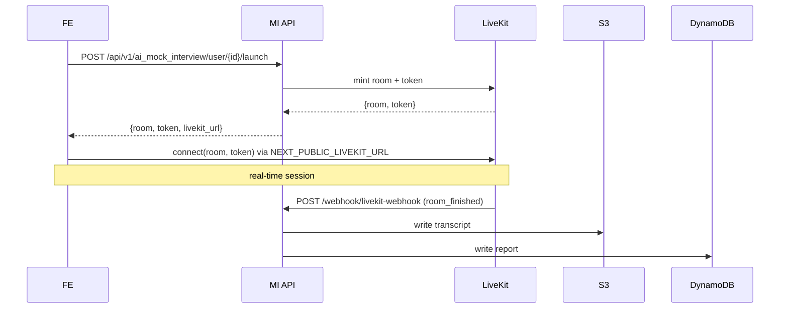

# Frontend ↔ Backend contract

How `ik-ai-mock-interview-fe` talks to `ik-ai-mock-interview-be` (plus Sentinel for auth). This page is the canonical cross-repo reference.

## Base URLs (names, not values)

| Purpose | FE env var | BE side |
|---|---|---|
| MI API (core) | `NEXT_PUBLIC_MI_API_BASE_URL` | `/api/v1/ai_mock_interview/*` |
| Recruiter / hiring admin | `NEXT_PUBLIC_RECRUITER_BASE_URL` | `/admin/api/*` (same BE host) |
| Sentinel auth | `NEXT_PUBLIC_SENTINEL_AUTH_BASE_URL` | separate service — see [`../services/sentinel.md`](../services/sentinel.md) |
| LiveKit | `NEXT_PUBLIC_LIVEKIT_URL` | token from BE `launch` |

**The wiki does not store the deployed URL values.** They live in the FE repo's `.env.*` and the BE deploy env. Current shape (QA/prod hosts) is documented in each repo's integrations page.

## Request contract

Every FE → BE call goes through `apiClient()` in `src/utils/apiUtils.ts` and carries:

| Header / cred | Source | What the BE does with it |
|---|---|---|
| `credentials: include` (cookies) | HttpOnly cookies set by Sentinel | `CognitoAuthMiddleware` extracts + verifies the JWT (see [`../services/cognito.md`](../services/cognito.md)) |
| `X-Api-Key` | `NEXT_PUBLIC_API_KEY` (via `getApiKeyHeaders()`) | **Open question for manager:** confirm the BE validates this header and where the key is issued |
| `X-Guest-Sub` | `guest_sub` in localStorage (guest flows only) | Identifies guests when no authenticated user is present |
| `Content-Type: application/json` | apiClient default | — |

**401 handling (FE side):** single-flight `POST /auth/refresh` to Sentinel → retry once → on failure, `redirectToLogout()` clears client state and sends the user to login.

## Launch flow (canonical round-trip)

## Representative endpoints

Prefixed with `/api/v1/ai_mock_interview` on the BE; called via `src/apis/*` hooks on the FE.

| FE hook (observed) | BE route | Notes |
|---|---|---|
| `useAuth*` | `POST /auth` | FE calls after Sentinel login to register session |
| `useGetUserInfo` | `GET /user-info` | Role routing happens on the result |
| `useLaunchInterviewApi` | `POST /user/{id}/launch` | Returns LiveKit room + token |
| `useGetInterviewMetadata` | `GET /interview/{id}/metadata` | |
| `useGetTranscript` | `GET /interview/{id}/transcript` | S3-backed |
| `useGetReportByIdApi` | `GET /interview/{id}/report` | DynamoDB-backed |
| terminate/feedback/rating | `PATCH|POST .../terminate`, `POST .../feedback`, `POST .../rating` | |
| topics | `GET /topics?round=` | |

**When extending:** add the FE hook under `src/apis/`, register the URL in `src/constants/apiConstants.ts`, and add the matching BE route in `routers/ai_mock_interview_router.py`. Keep this table in sync.

## CORS

BE sets `allow_origins=["*"]` + `allow_credentials=True` in code. That combination is **browser-rejected**, so the actual FE origin is allow-listed at the ALB/gateway layer. **Open question for manager:** confirm allowed origins per environment.

## Change-management note

Any time a FE↔BE contract changes:
1. Update this file in the same PR (or in the paired PR on the other repo).
2. Note the change in `log.md` with `learn | integrations | ...`.
3. If a new BE route is added, link it from both the repo's `integrations.md` and this page.
