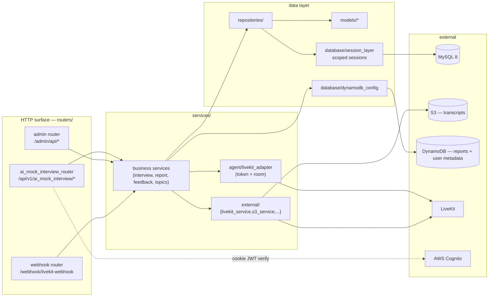
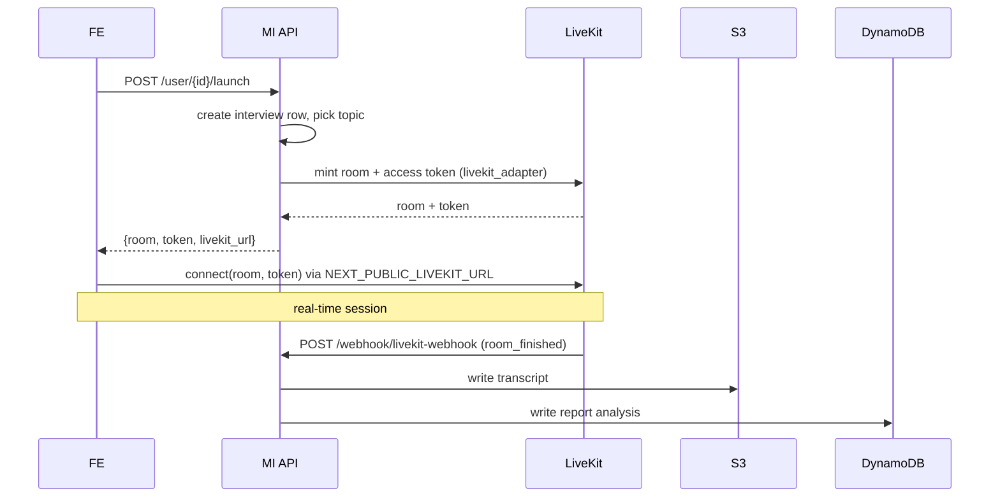

# ik-ai-mock-interview-be — architecture

## Request lifecycle (authenticated API call)

```mermaid
sequenceDiagram
    participant FE as Frontend SPA
    participant MW as CognitoAuthMiddleware
    participant R as Router / @require_authentication
    participant Svc as Service
    participant Repo as Repository
    participant DB as MySQL
    FE->>MW: HTTP (cookie JWT + X-Api-Key)
    MW->>MW: verify JWT vs JWKS (if enabled)
    MW->>MW: auto-refresh expired id_token (rewrites cookies)
    MW->>R: forward (soft; does not reject)
    R->>R: @require_authentication injects authenticated_user_sub
    R->>Svc: business call
    Svc->>Repo: via session_manager
    Repo->>DB: SQLAlchemy
    DB-->>FE: response
```

- Public endpoints (bypass middleware verification): `/health`, `/docs`, `/redoc`, `/openapi.json`, `/favicon.ico`, `/admin/api/health`.
- The **real auth gate** is the `@require_authentication()` route decorator, not the middleware (which is soft).

## Component map



## Data stores

| Store | Role | Access |
|---|---|---|
| **MySQL 8** | Primary relational — interviews, feedbacks, topics, platform configs, user data. | `DATABASE_URL`, SQLAlchemy 2 engine + pool, **scoped sessions via `session_manager`** (`database/session_layer.py`). **Never use raw `Session()`.** |
| **DynamoDB** | Report analysis + user metadata. | `database/dynamodb_config.py` + boto3. Tables from env (`DYNAMODB_INTERVIEW_REPORT_ANALYSIS_TABLE`, `DYNAMODB_USER_METADATA_TABLE`). |
| **S3** | Interview transcripts at `transcripts/{interview_id}/transcript.json`. | `services/external/s3_service.py`. Bucket from `S3_BUCKET_NAME`. |

## Interview launch flow (FE → BE → LiveKit)



## Auth strategy (plug point)

- `auth/factory.py` selects a strategy; today only `CognitoAuthenticationStrategy`.
- Verification toggled via `COGNITO_TOKEN_VERIFICATION_ENABLED` + user-pool ID. Locally defaulted off so the stack can start without reaching Cognito.
- Auto-refresh: expired `id_token` triggers `REFRESH_TOKEN_AUTH` to Cognito; middleware rewrites the response cookies.

See [`../../services/cognito.md`](../../services/cognito.md) for the Cognito side.

## Deployment (as observed in CI)

- `build-qa` / `build-prod` + `deploy-qa` / `deploy-production` in `.github/workflows/` — all `workflow_dispatch` only, branch-guarded (`qa`, `production`).
- Build → ECR → ECS (`IK-COMMON`, us-west-1).
- `MIGRATION_CUTOVER` repo variable: when false → "shadow" mode, quarantined `shadow-<sha>` image tags, no real ECS update. See [`conventions.md`](conventions.md).
