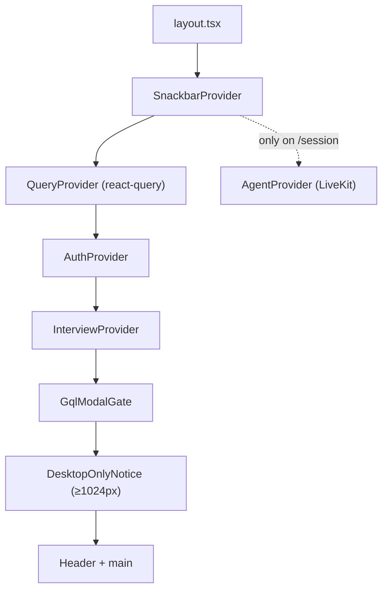
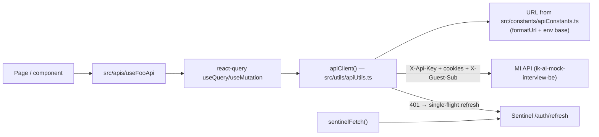
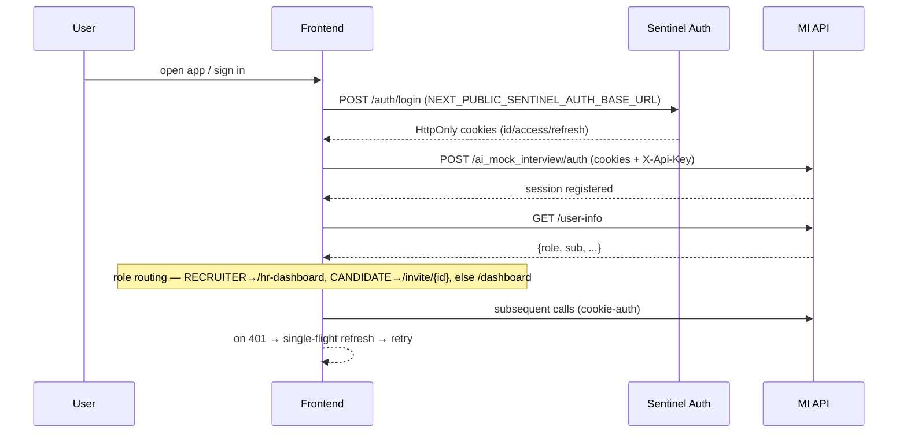

# ik-ai-mock-interview-fe — architecture

## Rendering model

App Router, **client-rendered SPA**. No server components doing data fetching, no server actions, no `app/api` route handlers. Build is a mix of static (`○`) and dynamic (`ƒ`) pages, but all data comes from the browser via React Query.

## Provider stack (`src/app/layout.tsx`)

- `AuthProvider` blocks protected routes with a spinner; public prefixes `/configurations`, `/session`, `/sessions` render without blocking.
- `ProtectedRoute` (in `components/`) gates by role; falls back to `/unauthorized`.
- `AgentProvider` only wraps the LiveKit session route.

## API client layer

- `apiClient()` — primary MI-API fetch wrapper. Adds JSON + `X-Api-Key` headers, `credentials:'include'`, injects `X-Guest-Sub` for guests. On 401: single-flight `POST /auth/refresh` to Sentinel, one retry, else `redirectToLogout()`.
- `sentinelFetch()` — auth-host variant, does **not** auto-logout.
- `formatUrl()` — fills `{placeholder}` endpoint tokens.
- All endpoint URLs are centralized in `src/constants/apiConstants.ts`; `getApiKeyHeaders()` returns `X-Api-Key`.
- ~26 React Query hooks under `src/apis/` (`useLaunchInterviewApi`, `useGetUserInfo`, `useSessionCapStatusApi`, `useGetReportByIdApi`, `useValidateInviteApi`, ...).

## Auth flow

- Cookie-session based. No JWT is ever read in JS. No NextAuth.
- Non-authoritative client mirror in `localStorage.auth_state`, `sessionStorage.auth_user`, `guest_sub` (for `X-Guest-Sub`).
- Logout clears storage + `redirectToLogout()`.

## Role routing (`src/app/page.tsx`)

- `RECRUITER` → `/hr-dashboard`
- `CANDIDATE` → `/invite/{id}`
- `SANDBOX` → tolerated
- else → `/dashboard`

## State & data

- **No Redux / Zustand.** Server state lives in React Query, local UI state in component state + context (`AuthProvider`, `InterviewProvider`).
- Snackbar for global messaging.

## External hits (sketch)

- MI API — all app data.
- Sentinel — login + refresh.
- LiveKit — join room (token from MI `launch`).
- Sentry — client error + perf traces.
- Clarity — session replay / analytics.
- Custom analytics — POSTs enriched events to AWS Execute-API with `x-api-key` + ipapi.co geo.
- FingerprintJS — guest identification.
