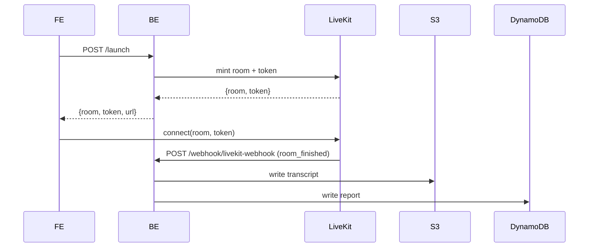

# LiveKit

Real-time audio/video for the live interview session.

## Flow

1. FE calls BE `POST /api/v1/ai_mock_interview/user/{id}/launch`.
2. BE mints a room + access token via `services/agent/livekit_adapter.py` and returns them.
3. FE connects to the LiveKit URL (`NEXT_PUBLIC_LIVEKIT_URL`) with the token via `livekit-client` / `@livekit/components-react` on the `/session/[roomId]` route.
4. When the room ends, LiveKit calls BE webhook `POST /api/v1/ai_mock_interview/webhook/livekit-webhook` (`room_finished`). BE kicks off transcript ([`s3.md`](s3.md)) and report ([`dynamodb.md`](dynamodb.md)) processing.

## Code

- BE: `services/agent/livekit_adapter.py` (tokens + room), `services/external/livekit_service.py` (admin ops), `routers/*` for the webhook.
- FE: `livekit-client`, `@livekit/components-react`, `AgentProvider` wrapping only the `/session` route.

## Env vars (names only)

| Side | Var |
|---|---|
| BE | `LIVEKIT_API_KEY` 🔑, `LIVEKIT_API_SECRET` 🔑, `LIVEKIT_URL` |
| FE | `NEXT_PUBLIC_LIVEKIT_URL`; plus `NEXT_PUBLIC_LIVEKIT_API_KEY` / `_SECRET` are present but likely vestigial — see `repos/ik-ai-mock-interview-fe/gotchas.md` |

See [`../env/README.md`](../env/README.md).

## Stay / hitch cascade (unresolved, 2026-11-13)

Found via INV-1185. The agent worker is in a **separate repo** called `uplevel-livekit-worker` — not in this workspace. Worker is dispatched by `RoomConfiguration(agents=[RoomAgentDispatch(agent_name="uplevel-livekit-worker")])` in BE `services/agent/livekit_adapter.py` (~L81), applied **once at room creation** — if it leaves, nothing auto-re-dispatches it.

Cascade when Chrome's native "Leave site?" prompt briefly hitches WebRTC:
1. Agent worker sees candidate "disconnect", leaves the room.
2. Room goes empty → LiveKit's `empty_timeout` fires (small default).
3. LiveKit posts `room_finished` → BE `terminate_session_webhook.py` marks interview `ABORTED` with no grace.

**Two-part fix (not yet implemented):**
- BE (`ik-ai-mock-interview-be`): raise `empty_timeout` to ~120s in `RoomConfiguration`; add minimum-duration guard in the `room_finished` webhook handler before marking ABORTED.
- Worker (`uplevel-livekit-worker`): 30–60s grace period before leaving on candidate disconnect; resume on reconnect.

Part 1 alone stops ABORTED rows but leaves the candidate reconnecting to a silent (no-agent) room.

See [`../repos/ik-ai-mock-interview-be/gotchas.md`](../repos/ik-ai-mock-interview-be/gotchas.md) and [`../repos/ai-mock-interview-fe-v2/overview.md`](../repos/ai-mock-interview-fe-v2/overview.md) → "Stay flow + mic cascade".

## Open questions

- Confirm FE-side LiveKit secret can be removed (server-side token is the design).
- Who owns `uplevel-livekit-worker` repo access? Needed to ship Part 2 of the Stay-cascade fix.
