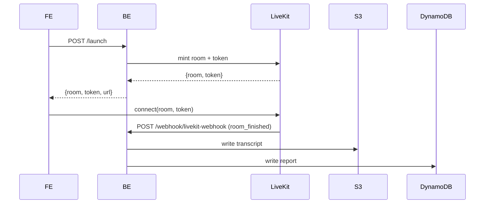

# LiveKit

Real-time audio/video for the live interview session.

## Flow

1. FE calls BE `POST /api/v1/ai_mock_interview/user/{id}/launch`.
2. BE mints a room + access token via `services/agent/livekit_adapter.py` and returns them.
3. FE connects to the LiveKit URL (`NEXT_PUBLIC_LIVEKIT_URL`) with the token via `livekit-client` / `@livekit/components-react` on the `/session/[roomId]` route.
4. When the room ends, LiveKit calls BE webhook `POST /api/v1/ai_mock_interview/webhook/livekit-webhook` (`room_finished`). BE kicks off transcript ([`s3.md`](s3.md)) and report ([`dynamodb.md`](dynamodb.md)) processing.

## Code

- BE: `services/agent/livekit_adapter.py` (tokens + room), `services/external/livekit_service.py` (admin ops), `routers/*` for the webhook.
- FE: `livekit-client`, `@livekit/components-react`, `AgentProvider` wrapping only the `/session` route.

## Env vars (names only)

| Side | Var |
|---|---|
| BE | `LIVEKIT_API_KEY` 🔑, `LIVEKIT_API_SECRET` 🔑, `LIVEKIT_URL` |
| FE | `NEXT_PUBLIC_LIVEKIT_URL`; plus `NEXT_PUBLIC_LIVEKIT_API_KEY` / `_SECRET` are present but likely vestigial — see `repos/ik-ai-mock-interview-fe/gotchas.md` |

See [`../env/README.md`](../env/README.md).

## Open questions

- Confirm FE-side LiveKit secret can be removed (server-side token is the design).
